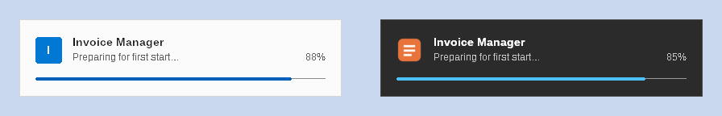

# pyxbuild

Build a Windows x64 application from a standard Python project — on macOS,
Linux or Windows. No compiler, no Wine, no virtual machine.

```console
$ pyxbuild build
[win_amd64] Python 3.12 runtime (python-build-standalone)
[win_amd64] building wheel for myapp
[win_amd64] resolving 2 requirement(s) with uv
[win_amd64] installing 14 wheel(s)
[win_amd64] built dist/myapp-win_amd64
```

```
dist/myapp-win_amd64/
├── myapp.exe            ← launcher (one per entry point)
└── runtime/             ← CPython for Windows + your wheels in Lib/site-packages
```

Copy the folder (or the `--zip`) to any Windows 10/11 x64 machine; no Python
or Visual C++ Redistributable needs to be installed.

## How it works

Building an `.exe` here means *assembling*, not compiling:

1. download a prebuilt CPython for Windows ([python-build-standalone],
   pinned by version and sha256);
2. resolve dependencies **for the target** (`sys_platform == "win32"`,
   `platform_machine == "AMD64"`) with `uv pip compile --python-platform`,
   written to a standard `pylock.toml` (PEP 751);
3. install the `win_amd64` wheels into the runtime's `site-packages` with the
   PyPA `installer` library — no code from the wheels is run;
4. copy a small prebuilt launcher (C, compiled once with `zig cc` and
   shipped inside pyxbuild) and append a manifest naming the entry point.

The result is byte-for-byte the same on every build host.

## Usage

```toml
[project]
name = "myapp"
version = "1.2.0"
requires-python = ">=3.12"
dependencies = ["requests>=2.32", "PySide6"]

[project.gui-scripts]
myapp = "myapp.main:run"

[tool.pyxbuild]            # everything is optional
targets = ["win_amd64"]
python = "3.12"            # default: newest supported allowed by requires-python
mode = "folder"            # or "onefile": a single .exe (see below)
lock = "pylock.toml"       # default: pylock.win_amd64.toml
exclude = ["tests/", "*.pyi"]
zip = true
utf8-mode = false          # run the app with -X utf8
icon = "assets/app.ico"    # launcher icon; VERSIONINFO comes from [project]
find-links = ["wheels/"]   # extra local wheels (e.g. built in CI)
slim = ["tests", "idle", "ensurepip", "turtledemo", "lib2to3", "tk"]  # drop stdlib parts
bytecode = true            # precompiled .pyc: fast first start, read-only folders
pure-python = ["msgpack"]  # build without the optional C extension (no wheel case)
cross-compile = ["markupsafe"]  # experimental: compile C extensions with zig
app-id = "Acme.MyApp"      # GUI: taskbar identity (AppUserModelID)
truststore = true          # use the Windows certificate store for TLS

[tool.pyxbuild.env]        # set at start-up; {app_dir} {data_dir} {localappdata}
NLTK_DATA = "{app_dir}\\nltk_data"

[tool.pyxbuild.version-info]
company-name = "ACME"
copyright = "(c) 2026 ACME"
```

```console
pyxbuild build [--target win_amd64] [--python 3.12] [--zip] [--frozen | --offline]
pyxbuild lock                    # resolve only, (re)write pylock.win_amd64.toml
pyxbuild doctor                  # missing wheels, missing DLLs, VC++ runtime, long paths
pyxbuild sign dist/myapp-win_amd64 --cert cert.pfx --password-env PFX_PASSWORD
```

Commit the lock file: `pyxbuild build --frozen` then never resolves again, and
`--offline` builds from the download cache only.

### One file

`mode = "onefile"` (or `pyxbuild build --mode onefile`) produces
`dist/<script>.exe` alone: the application folder travels inside the
executable as a compressed archive. Windows can only load DLLs and `.pyd`
files from disk, so the launcher extracts it:

* `onefile-extract = "cache"` (default): once per version, into
  `%LOCALAPPDATA%\pyx\<app>\<hash>\`; later starts reuse it and are as fast
  as the folder mode. Extraction goes to a temporary folder that is renamed
  when complete, under a named mutex, so concurrent or interrupted first
  starts are safe; the previous version is kept, older ones are removed.
  `PYX_ONEFILE_DIR` changes the location, `PYX_ONEFILE_RESET=1` re-extracts.
* `onefile-extract = "temp"`: like PyInstaller, into `%TEMP%` on every start,
  deleted when the application exits (folders of killed runs are swept on a
  later start).

GUI apps show a small progress window while the first extraction runs
(only if it takes longer than 0.4 s; `PYX_ONEFILE_PROGRESS=0` turns it off).
By default it is drawn in the Windows 11 style: the app's icon and name
(`version-info` `product-name`, else the project name), the user's accent
color, light or dark like Windows, sharp on scaled displays, rounded corners
on Windows 11; it never takes the focus. `onefile-progress = "classic"` shows
a plain box with the percentage instead, `"off"` nothing. Under Wine:



Combine it with `bytecode = true` for a fast first start. `{app_dir}` in
`[tool.pyxbuild.env]` is the extracted folder (bundled data), `{exe_dir}` the
folder of the `.exe`. `pyxbuild sign dist/myapp.exe` signs it, archive
included. The launcher stays free of the C runtime (19 KB, 26 KB with the GUI window; its own DEFLATE
decoder).

### Updates (patch executables)

Users of a onefile app (cache mode) do not need to download the whole new
executable again:

```
pyxbuild patch --from v1/myapp.exe --to dist/myapp.exe     # -> myapp-update-2.0.exe
```

writes a small executable with only what changed: files whose content the
installed version already has (at any path) are reused, the rest travels in
the patch. With `--fetch-public` the files of public wheels from the lock file
(`--lock`, default `pylock.win_amd64.toml`) are not carried; the patch
downloads those wheels from their URLs when it runs and checks their sha256.
Your own code and private/local wheels always travel inside the patch.

Running the patch builds the new version next to the installed one (reused
files are hard-linked after checking their hashes; every written file is
checked), with the installed version's Python, so the result is the folder
the new full executable would extract. The old `myapp.exe` then starts the
new version, and the new `myapp.exe` finds it ready. A patch for a version
that is not installed on that computer says so and changes nothing. A change
of only your code makes a patch of a few tens of KB.

### Monorepos

Dependencies on sibling packages through uv's `[tool.uv.sources]` work:
`{ workspace = true }` (members of the uv workspace above the project) and
`{ path = "../tools" }` (a folder or a `.whl`). pyxbuild builds those packages
from the checkout like the project itself, installs them next to it and
resolves only their dependencies, so the lock never names them and stays
portable. `directory` entries of a PEP 751 lock exported by another tool
(`uv export --format pylock.toml`) are built the same way. Local packages must
be pure Python (a package with compiled code: build its `win_amd64` wheel in
CI and add it through `find-links`).

Files found through `find-links` are written to the lock as paths relative to
the lock file, also above the project (`find-links = ["../../wheels"]` →
`path = "../../wheels/x.whl"`), so `--frozen` works on any checkout with the
same layout. Only a folder on another Windows drive is kept as an absolute
`file://` URL.

## Limits

* Every dependency needs a `win_amd64`, `abi3` or pure-Python wheel on the
  index, or one of the fallbacks in [docs/NO_WHEEL.md](docs/NO_WHEEL.md)
  (`pure-python`, Windows-CI wheels via `find-links`, experimental
  `cross-compile` with zig — 14 of 19 tested sdists build that way).
* The project itself must be pure Python.
* Some wheels need Visual C++ runtime DLLs that Windows does not ship
  (torch, ...). `pyxbuild doctor` lists them; add `msvc-runtime` to the
  dependencies to bundle them.
* Only the `win_amd64` target exists so far.

Documentation: [design](docs/DESIGN.md) · [testing](docs/TESTING.md) ·
[compatibility matrix](docs/COMPATIBILITY.md) (38 packages × Python 3.11–3.14) ·
[real applications](docs/APPS.md) (Django, FastAPI, Streamlit, JupyterLab, zig cross-compiled extensions, … — 22 of 23 work) ·
[no wheel for the target?](docs/NO_WHEEL.md) ·
[real-world issues and coverage](docs/REAL_WORLD_ISSUES.md) ·
[benchmarks vs PyInstaller](docs/BENCHMARKS.md) ·
[Go / TypeScript comparison](docs/GO_TYPESCRIPT.md) ·
[open questions](docs/OPEN_QUESTIONS.md).

`pyxbuild doctor` also checks the project's own imports (undeclared
dependencies, POSIX-only modules such as `fcntl`), DLLs and the VC++ runtime,
several OpenMP runtimes, packages held back for lack of wheels, and packages
known to download data or compile at run time.

[python-build-standalone]: https://github.com/astral-sh/python-build-standalone

## Development

```console
pip install -e ".[dev,stubs]"
pytest -m "not slow"                       # unit tests, seconds
eval "$(tools/get_wine.sh)"                # Wine 11 for running apps on Linux
pytest -m "slow and not golden"            # build + run real apps
pytest -m golden                           # golden set (numpy, pandas, Qt, ...)
python tools/build_stubs.py --check        # committed launchers == source
```
